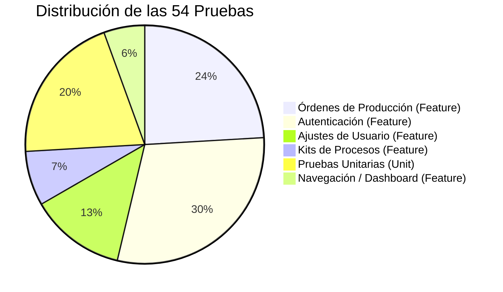

# Estado y Resumen de la Suite de Pruebas

**Fecha de verificación:** 25 de Octubre de 2026  
**Proyecto:** `maco` (Laravel 11 + Vue 3 + Inertia.js)  
**Base de datos de testing:** `maco_tests` (MySQL)  
**Herramienta:** PHPUnit / Pest / `php artisan test`  

---

## 1. Estado General de la Suite

| Métrica | Valor |
|---------|-------|
| **Estado global** | **PASANDO (100%)** |
| **Total de pruebas** | **54** |
| **Total de aserciones** | **212** |
| **Pruebas fallidas** | **0** |
| **Tiempo de ejecución** | ~13.7s - 14.9s |

---

## 2. Distribución de Pruebas



---

## 3. Resumen Detallado por Suite

### A. Pruebas Unitarias (`tests/Unit/`) — 11 pruebas

| Archivo | Prueba | Descripción |
|---------|--------|-------------|
| `ExampleTest.php` | `test_that_true_is_true` | Prueba base de sanidad para validar la inicialización de PHPUnit y el trait `RefreshDatabase`. |
| `ListaDesplegableServiceTest.php` | `test_it_creates_a_lista_desplegable_successfully` | Verifica la creación de registros en `listas_desplegables` mediante el patrón Service/Repository (`ListaDesplegableService` / `ListaDesplegableRepository`), validando la entidad retornada y la persistencia en BD. |
| `ListaDesplegableServiceTest.php` | `test_it_fetches_options_grouped_by_subcategoria` | Verifica que el servicio agrupe adecuadamente por `subcategoria` las opciones pertenecientes a una categoría padre (`presupuesto`). |
| `LocaleControllerTest.php` | `test_it_updates_locale_to_english_in_session` | Verifica que una petición POST a `locale.update` con `'en'` almacene el locale en la sesión y redirija. |
| `LocaleControllerTest.php` | `test_it_updates_locale_to_spanish_in_session` | Verifica que una petición POST a `locale.update` con `'es'` almacene el locale en la sesión y redirija. |
| `NotificacionesManagerTest.php` | `test_it_creates_a_notification_for_a_user_successfully` | Verifica que `NotificacionesManager::crear()` registre una notificación para un usuario específico con su prioridad y mensaje correspondiente. |
| `NotificacionesManagerTest.php` | `test_it_filters_notifications_by_user_and_global` | Verifica el método `noLeidas()`, garantizando que un usuario reciba sus notificaciones individuales y las globales (`user_id = null`), excluyendo las de otros usuarios. |
| `NotificacionesManagerTest.php` | `test_it_marks_a_notification_as_read` | Comprueba que `marcarComoLeida()` actualice el flag `leida` a 1 en la base de datos y retorne `true`. |
| `OrdenProduccionDistribucionTallasTest.php` | `test_it_loads_product_with_its_tallas_distribution` | Valida la relación Eloquent entre `Producto` y `Distribucion_por_tallas`, verificando que la carga diferida (`with`) entregue correctamente las tallas asociadas y sus cantidades planificadas. |
| `UpdateModelAttributesTest.php` | `test_it_fails_when_model_is_not_configured` | Valida que el comando de consola `copy:attr` falle con código de salida 1 y mensaje de error descriptivo ante un modelo no existente o no configurado. |
| `UpdateModelAttributesTest.php` | `test_it_rejects_a_real_model_that_is_not_allowlisted` | Valida que un modelo real (`Talla`) que no está incluido en la lista permitida del comando sea rechazado de forma segura sin mutar código fuente. |

---

### B. Pruebas de Característica (`tests/Feature/`) — 43 pruebas

#### 1. Flujo de Órdenes de Producción (`tests/Feature/OrdenProduccionTest.php`) — 13 pruebas
Cubre el ciclo de vida completo de las órdenes de producción (OP), recepción de calidad, reparación y subprocesos externos:

1. **`test_se_puede_guardar_una_nueva_op`**: Comprueba la creación de una OP con numeración correlativa generada en backend (ej. `OP-100`), asignación de estado de materiales inicial (`Pendiente`), estado operativo (`Preparación`) y marca de proceso externo.
2. **`test_al_recibir_sin_reparaciones_la_op_se_cierra`**: En la recepción de calidad, si todas las prendas son aprobadas y 0 en reparación, la OP transiciona de inmediato a `Cerrada` y genera el registro en `cierre_orden_produccions`.
3. **`test_al_recibir_con_reparaciones_la_op_queda_en_recibiendo`**: Si existen prendas defectuosas, la OP se mantiene en `Recibiendo`, registra `recepcion_desde` y genera los compromisos de reparación con fecha límite en `compromisos_reparacion`.
4. **`test_desde_recibiendo_actualiza_la_recepcion_y_la_cierra`**: Permite reabrir una recepción previa en estado `Recibiendo`, subsanar las reparaciones pendientes y cerrar la orden al quedar en 0 unidades a reparar.
5. **`test_el_index_entrega_las_recepciones_para_precargar_el_modal`**: Asegura que el controlador del `Index` entregue a Inertia las recepciones y compromisos anteriores para precargar el modal de calidad.
6. **`test_el_index_entrega_materiales_y_tallas_para_el_detalle_del_estado`**: Comprueba que la vista principal reciba el desglose de materiales requeridos, disponibles, faltantes y la distribución de tallas por producto.
7. **`test_no_se_puede_cerrar_la_op_con_pares_en_reparacion`**: Impide que el usuario fuerce el paso a `Cerrada` si el formulario aún contiene pares en reparación (arroja error de validación).
8. **`test_no_se_puede_cerrar_la_op_desde_pendiente_si_quedan_reparaciones`**: Impide el cierre directo desde otros estados si existen registros previos con reparaciones sin resolver.
9. **`test_se_puede_cerrar_la_op_cuando_no_quedan_pares_en_reparacion`**: Valida el cierre exitoso y la limpieza de `recepcion_desde` cuando no hay pendientes de reparación.
10. **`test_al_pasar_a_procesos_externos_registra_los_materiales_del_kit`**: Al cambiar a `Procesos externos`, registra en `proceso_externos` cada material enviado al proveedor externo con su cantidad y fecha de salida.
11. **`test_no_pasa_a_procesos_externos_sin_registrar_materiales`**: Bloquea el cambio a `Procesos externos` si no se especifican los materiales o el proveedor de destino.
12. **`test_lista_para_taller_registra_la_fecha_real_de_regreso`**: Al reingresar de procesos externos a `Lista para taller`, registra la fecha real de retorno del material procesado.
13. **`test_no_pasa_a_lista_para_taller_sin_fecha_de_regreso`**: Bloquea la transición a `Lista para taller` si hay procesos externos pendientes y no se provee la fecha real de regreso.

#### 2. Kits de Proceso (`tests/Feature/KitProcesoTest.php`) — 4 pruebas
1. **`test_la_op_genera_un_kit_por_material_de_la_ficha`**: Al persistir una OP, genera automáticamente un ítem en `KitProceso` por cada material de la ficha técnica calculando `consumo_estandar * cantidad_producto`.
2. **`test_la_op_actualiza_la_cantidad_de_la_plantilla_de_tallas_al_crearse`**: Al crear la orden desde una plantilla de tallas en cero, actualiza la distribución con las cantidades digitadas por el usuario y alimenta el kit.
3. **`test_el_index_agrupa_los_estados_requeridos`**: Agrupa y unifica variantes ortográficas/morfológicas de un mismo estado (ej. "Terminado" y "Terminada") en el resumen del index.
4. **`test_actualizar_kits_de_la_op_calcula_falta_y_listo`**: Al actualizar kits mediante `update-por-orden`, calcula automáticamente el faltante (`disponible - preparada`) y marca el estado `listo`.

#### 3. Autenticación (`tests/Feature/Auth/`) — 16 pruebas
- **`AuthenticationTest.php`** (4):
  - `test_login_screen_can_be_rendered`: Renderizado HTTP 200 de la vista `/login`.
  - `test_users_can_authenticate_using_the_login_screen`: Login exitoso con credenciales válidas y redirección al dashboard.
  - `test_users_can_not_authenticate_with_invalid_password`: Rechazo de contraseña incorrecta manteniendo estado `guest`.
  - `test_users_can_logout`: Cierre de sesión vía POST a `/logout` y redirección a inicio.
- **`EmailVerificationTest.php`** (3):
  - `test_email_verification_screen_can_be_rendered`: Renderizado de pantalla de aviso de verificación.
  - `test_email_can_be_verified`: Verificación mediante URL temporal firmada y disparo del evento `Verified`.
  - `test_email_is_not_verified_with_invalid_hash`: Rechazo de firmas o hashes adulterados en la verificación.
- **`PasswordConfirmationTest.php`** (3):
  - `test_confirm_password_screen_can_be_rendered`: Renderizado de pantalla para confirmar clave en acciones sensibles.
  - `test_password_can_be_confirmed`: Confirmación exitosa con la contraseña actual.
  - `test_password_is_not_confirmed_with_invalid_password`: Validación de error ante clave errónea.
- **`PasswordResetTest.php`** (4):
  - `test_reset_password_link_screen_can_be_rendered`: Renderizado de pantalla de solicitud de enlace.
  - `test_reset_password_link_can_be_requested`: Generación y envío del correo con notificación `ResetPassword`.
  - `test_reset_password_screen_can_be_rendered`: Renderizado de pantalla de cambio de clave con token.
  - `test_password_can_be_reset_with_valid_token`: Actualización exitosa de contraseña con token válido y redirección a login.
- **`RegistrationTest.php`** (2):
  - `test_registration_screen_can_be_rendered`: Renderizado de formulario de registro.
  - `test_new_users_can_register`: Creación de usuario, autenticación automática y redirección al dashboard.

#### 4. Ajustes y Perfil de Usuario (`tests/Feature/Settings/`) — 7 pruebas
- **`PasswordUpdateTest.php`** (2):
  - `test_password_can_be_updated`: Cambio de clave desde el panel de ajustes comprobando el nuevo hash.
  - `test_correct_password_must_be_provided_to_update_password`: Exigencia de contraseña actual correcta para autorizar el cambio.
- **`ProfileUpdateTest.php`** (5):
  - `test_profile_page_is_displayed`: Renderizado de la vista de perfil de usuario.
  - `test_profile_information_can_be_updated`: Modificación de nombre y correo, reiniciando `email_verified_at` ante cambio de email.
  - `test_email_verification_status_is_unchanged_when_the_email_address_is_unchanged`: Conservación de verificación de email si la dirección no se altera.
  - `test_user_can_delete_their_account`: Eliminación lógica de cuenta (`SoftDeletes`) con confirmación de clave y cierre de sesión.
  - `test_correct_password_must_be_provided_to_delete_account`: Rechazo de eliminación de cuenta si la contraseña es inválida.

#### 5. Navegación y Vistas Base — 3 pruebas
- **`Feature\ExampleTest.php`** (1):
  - `test_returns_a_successful_response`: Verifica que la raíz `/` redirija al login.
- **`Feature\DashboardTest.php`** (2):
  - `test_guests_are_redirected_to_the_login_page`: Redirección de invitados al intentar acceder a `/dashboard`.
  - `test_authenticated_users_can_visit_the_dashboard`: Acceso HTTP 200 al dashboard para usuarios autenticados.

---

## 4. Instrucciones para Ejecución Local

Para correr toda la suite de pruebas o filtros individuales:

```bash
# Ejecutar toda la suite
php artisan test

# Ejecutar únicamente pruebas unitarias
php artisan test --testsuite=Unit

# Ejecutar únicamente pruebas de integración/feature
php artisan test --testsuite=Feature

# Filtrar por clase o método específico
php artisan test --filter=OrdenProduccionTest
```
